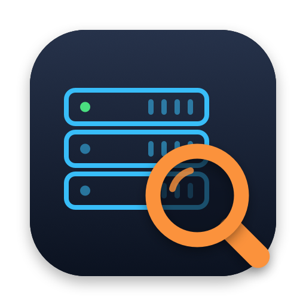

<p align="center"></p>

<h1 align="center">ServerFinder</h1>

<p align="center">
  Find files on your office server instantly, by name or by the words inside them.<br>
  A free, open-source menu bar app for macOS.
</p>

<p align="center">
  <a href="https://github.com/ulloa09/ServerFinder/releases/latest/download/ServerFinder.dmg"></a>
  <a href="https://github.com/ulloa09/ServerFinder/releases/latest"></a>
  <a href="https://github.com/ulloa09/ServerFinder/actions/workflows/tests.yml"></a>
  
  <a href="LICENSE"></a>
</p>

## Why

Finder can't search shared server folders (SMB) well: Spotlight doesn't index network
volumes, so searches come back empty or take forever. ServerFinder keeps its own list of the
file names on the folders you choose, on your Mac, and searches that list as you type.

It only reads. It never changes, moves or deletes anything on the server, and everything it
reads stays on your Mac.

## Features

- **Instant name search** across every connected server folder, from anywhere with **⌥ Space**.
- **Search inside documents**: PDF, Word, PowerPoint, Excel (.xlsx and .xls), RTF, text, CSV
  and XML, with a preview of the matching text.
- **Text recognition** for scanned PDFs and pictures (.jpg, .png, .heic, .tiff), in Spanish
  and English, using the recognition built into macOS.
- **Works offline**: results come from the last scan; opening an offline result reconnects
  to the server first.
- **Keyboard first**: open, Quick Look, show in Finder, copy the path, or drag a result into
  Mail, WhatsApp or any other app.
- **Private by design**: no account, no tracking, nothing sent anywhere. Files whose names
  look like passwords are found by name but their contents are never read.
- **Light on your Mac**: indexes in the background at low priority, pauses recognition in
  Low Power Mode, and uses no CPU when idle.
- English and Spanish.

## Install

1. [Download **ServerFinder.dmg**](https://github.com/ulloa09/ServerFinder/releases/latest/download/ServerFinder.dmg),
   open it and drag **ServerFinder** into **Applications**.
2. Open ServerFinder. macOS says it can't verify the app: click **Done**.
3. Open **System Settings → Privacy & Security**, scroll down to the message about
   ServerFinder and click **Open Anyway**, then confirm with your password.

You only do this once. macOS asks because the app isn't signed with a paid Apple developer
certificate; it's free and open source, so you can read every line of the code here, or
[build it yourself](#building-from-source). Each release lists the SHA-256 checksum of the
disk image if you want to check your download.

**Requires** macOS 15 Sequoia or later, on Apple silicon or Intel, and a server folder you
connect to in Finder over SMB (Windows Server, or a NAS that shares over SMB).

## Using it

1. Connect to the server in Finder as usual (**Go → Connect to Server…**).
2. Open ServerFinder. The first time, Settings opens: click **Add** next to the connected
   server folders you want to search (or **Add Folder…** to pick a subfolder).
3. Press **⌥ Space** in any app (or click the magnifying glass in the menu bar) and type
   part of a file name.

### Searching

- Accents and capitals don't matter: `cotizacion` finds `Cotización.xlsx`.
- Type several words to narrow down: `acme 2024 plano`. Words can also be folder names
  anywhere in the path, including the shared folder itself (`1a examen`).
- Limit to file types with `.pdf` or `ext:pdf` (several: `ext:pdf,docx`). Folders show up as
  results too; opening one opens it in Finder.
- Exact names come first, then names containing every word, then files found through their
  folders; newer files first within each group.
- Words written *inside* documents appear in the **Inside files** tab (press **Tab** to
  switch from **Names**), with a preview of the matching text. Inside documents, words match
  from their beginning (`cotiz` finds "cotización").

### Shortcuts

| Key | Action |
| --- | --- |
| **⌥ Space** | Open the search panel from any app (change it in **Settings → General**) |
| **↑ / ↓** | Pick a result |
| **Return** (or double-click) | Open it |
| **Space** / **⌘Y** | Preview it with Quick Look (Space once you've moved with ↑/↓) |
| **⌘Return** | Show it in Finder |
| **⌘C** | Copy its full path |
| **Tab** | Switch between **Names** and **Inside files** |
| **Esc** | Clear the text; press again to close |

Right-click a result for the same options, or drag it into another app. Right-click the menu
bar icon to see each folder's status, and for **Rescan Now**, **Settings…** and **Quit**.

### Keeping the list fresh

The list refreshes on its own: when ServerFinder starts, whenever a server folder connects,
and every 2 hours while it stays connected (change it in **Settings → General**).
Disconnecting mid-scan keeps the previous list. **Rescan Now** refreshes everything right
away. On a folder's first scan, results appear while it's still indexing.

Documents are read in the background after each scan; later only new or changed files are
read again. Scanned PDFs and pictures are recognized after everything else (about a third of
a second per page, up to 100 pages per document). **Settings → Contents** turns this on or
off per file type, sets the largest file to read (20 MB by default), shows progress, and can
erase all stored document text.

### Settings worth knowing

- **Open With**: open a file type with a specific app (e.g. `.pdf` with Adobe Acrobat instead
  of Preview). Only affects files opened from ServerFinder.
- **Excluded**: folders and files to leave out (`*` and `?` work as wildcards; a pattern with
  `/`, like `Backups/Old`, leaves out one folder). Windows system folders, `Thumbs.db`,
  `desktop.ini` and Office lock files are left out already.
- **Never read the contents of**: names like `*contraseña*`, `*password*` or `*clave*` are
  still found by name, but their text is never read; adding a pattern deletes any text
  already stored for it.
- **Open ServerFinder when you log in**, in **Settings → General**.

## Privacy

ServerFinder only talks to your own server, through the connection macOS already made. It has
no account, no analytics and no network requests of its own. The list of names and the text
of documents are kept in one file on your Mac (see [below](#where-data-lives)), and
**Settings → Contents** can erase all stored text at any time.

## FAQ

**macOS says "ServerFinder can't be opened" or "Apple could not verify…".**
Follow step 3 of [Install](#install). It's needed once, because the app isn't signed with a
paid Apple developer certificate.

**Does it work over VPN or from home?**
Yes, as long as you can connect to the server in Finder. Without a connection you can still
search the last scan; results are marked **Offline**.

**Does it work with servers other than Windows?**
It works with any shared folder mounted over SMB, such as a NAS. It has been used most with
Windows Server.

**How do I uninstall it?**
Quit it from the menu bar icon, delete it from Applications, and delete
`~/Library/Application Support/ServerFinder`.

## Building from source

Requires macOS 15 or later and the Swift toolchain (Xcode, or just the Command Line Tools:
`xcode-select --install`).

```sh
scripts/build-app.sh            # builds build/ServerFinder.app
scripts/build-app.sh --install  # also copies it to /Applications
scripts/test.sh                 # runs the tests
scripts/release.sh 1.0.0        # builds build/ServerFinder.dmg for Apple silicon and Intel
scripts/make-icons.sh           # redraws the icons from scripts/make-icon.swift
```

During development, `swift run ServerFinder` starts the app without bundling it (in English,
since translations are only added to the bundle).

Pushing a version tag (`git tag v1.0.0 && git push origin v1.0.0`) runs the tests on GitHub,
builds the disk image and attaches it to a draft release to review and publish.

See [docs/PRD.md](docs/PRD.md) for the full design.

## Where data lives

- Index: `~/Library/Application Support/ServerFinder/index.sqlite` (safe to delete; it's
  rebuilt on the next scan)
- Settings: the `com.ulloa09.ServerFinder` preferences domain

## License

[MIT](LICENSE) © Mauricio Martínez Ulloa
